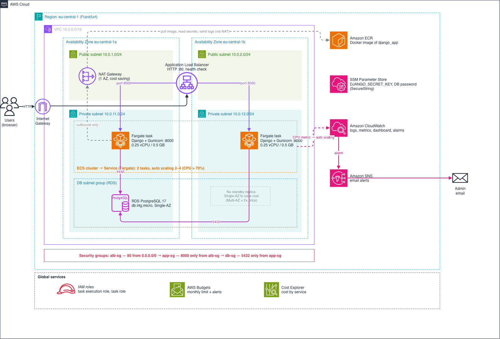

# Архітектура проєкту

Вихідний файл схеми: [`architecture.drawio`](architecture.drawio) (відкривається на app.diagrams.net).

## 1. Що я розгортаю

Для проєкту я взяв `django_app` з практичних занять курсу: це вебзастосунок для опитувань на Django з базою PostgreSQL. Спочатку я запустив його локально в Docker разом із базою, щоб переконатися, що він працює. Потім підготував образ до хмари: замінив сервер розробки на Gunicorn, виправив налаштування `DEBUG` і додав віддачу статичних файлів через WhiteNoise.

Регіон: `eu-central-1` (Франкфурт), найближчий до мене.

## 2. Чому ECS на Fargate

На курсі ми розглядали кілька способів запустити застосунок в AWS:

- **EC2.** Звичайний віртуальний сервер. Дає повний контроль, але все доводиться робити вручну: встановлювати й оновлювати систему, ставити Docker, налаштовувати масштабування.
- **Elastic Beanstalk.** Майже все робить автоматично: сам створює сервери, балансувальник і масштабування. Як зазначав викладач, через цю автоматизацію він дорожчий, і в ньому менше видно, що відбувається «під капотом».
- **ECS на Fargate.** Щось середнє між ними. Я сам описую, що запускати (Docker-образ, кількість копій, ресурси), а сервери під контейнерами AWS бере на себе.

Я обрав **ECS на Fargate**, бо:

1. мій застосунок уже запакований у Docker-образ, і він без змін запускається в AWS;
2. не треба керувати серверами, як в EC2, але при цьому я розумію й налаштовую кожну частину інфраструктури, на відміну від Beanstalk;
3. цю ж схему (Docker → ECR → ECS Fargate) я планую використати у своєму дипломному проєкті, тож фінальний проєкт для мене ще й підготовка до нього.

EKS (Kubernetes) я не брав: для одного невеликого застосунку це занадто складно.

## 3. Мережа

- Створюю власну мережу **VPC** у двох зонах доступності (два окремі дата-центри AWS). Якщо одна зона перестане працювати, сайт продовжить працювати в другій.
- **Публічні підмережі:** тут лише те, що має бути доступне з інтернету, тобто балансувальник (ALB) і NAT Gateway.
- **Приватні підмережі:** тут застосунок і база даних. З інтернету до них зайти неможливо.
- **NAT Gateway** потрібен, щоб застосунок із приватної мережі міг сам виходити назовні: завантажити Docker-образ, прочитати секрети, відправити логи.

## 4. Безпека

- **Security groups працюють як фаєрволи,** і кожен шар пускає лише попередній:
  - інтернет → балансувальник (порт 80);
  - балансувальник → застосунок (порт 8000);
  - застосунок → база даних (порт 5432).
- **Паролі та секретний ключ Django** зберігаються в **SSM Parameter Store** у зашифрованому вигляді. У коді й у Docker-образі їх немає.
- **IAM-ролі** дають ECS лише потрібні права: завантажити образ, прочитати секрети, писати логи.
- **База даних** не має публічного доступу.

## 5. База даних

- **RDS PostgreSQL:** та сама база, що й локально, тож у коді нічого міняти не довелося.
- **Найменший клас** (`db.t4g.micro`), бо навантаження навчальне.
- **Підключення до бази:** застосунок працює через Gunicorn з 2 воркерами, тож з'єднань з базою мало. Django тримає з'єднання відкритими й використовує їх повторно, а не відкриває нове на кожен запит.
- **Таблиці й адміністратор** створюються разовим запуском того самого образу в ECS, окремий сервер для цього не потрібен.

## 6. Балансування, масштабування, моніторинг

- **Application Load Balancer** отримує запити з інтернету й розподіляє їх між копіями застосунку. Він також перевіряє, чи кожна копія «жива».
- **Автомасштабування:** працюють мінімум 2 копії застосунку (по одній у кожній зоні). Якщо навантаження на процесор перевищує 70%, ECS додає копії, максимум до 4. Коли навантаження спадає, зайві копії прибираються.
- **CloudWatch** збирає логи й метрики. При проблемах (високе навантаження, помилки на сайті) спрацьовує сповіщення, і через **SNS** мені приходить лист на пошту.
- Витрати контролюю через **AWS Budgets** і **Cost Explorer**.
